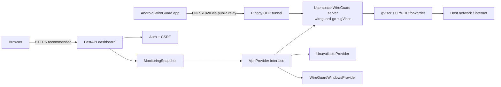

# RubeVPN V1 — Implementation, Deployment and Reuse Guide

**Document status:** living engineering record  
**Last updated:** 2026-11-25  
**Scope:** what is actually built, what has been verified, how to deploy it on GitHub, and how to reuse it on a new machine.

> This project deliberately separates *working software* from *claimed VPN operation*.
> Status values shown by the dashboard come from real observations. No client,
> handshake, or traffic statistic is fabricated.

---

## 1. Truth table

| Capability | State | Evidence |
|---|---|---|
| Repository structure, CI workflows | Implemented | Files present; workflows not yet run on GitHub |
| Python 3.12 backend, config validation, structured logs | Implemented | `backend/app/*`, 44 passing tests |
| Authenticated dashboard with real backend data | Implemented | API tests + live smoke test (`/`, `/health`, 401 on status) |
| API authentication / invalid credentials rejected | Implemented | `tests/test_api.py` |
| Secret redaction in logs | Implemented | `tests/test_logging.py` |
| Preflight and diagnostics scripts | Implemented | Executed locally; honest blockers reported |
| Windows WireGuard provider + setup script | Implemented, unit tested | `tests/test_windows_wireguard.py`, `tests/test_setup_windows.py` |
| Experimental userspace WireGuard + UDP tunnel | Implemented, handshake verified | `VERIFY_OK reply_bytes=89` through the public endpoint |
| `start.bat` / `stop.bat` one-click runtime | Implemented | First-run and reuse paths exercised; QR auto-opens |
| CI workflows on GitHub | **Not verified** | No remote push performed |
| Native WireGuard on an eligible public host | **Not implemented / not verified** | Requires authorized host (public IPv4, UDP inbound, elevation) |
| Android import on a real device | **Reported working by operator; not independently verified here** | Official WireGuard app / QR import |
| IPv4 routing / DNS through experimental stack | Verified via tunneled DNS reply | `peercheck` end-to-end test |
| IPv6 leak prevention | **Not implemented** | IPv6 is not routed by the experimental stack |
| Session expiry, shutdown detection, reconnection eligibility | **Not implemented** | Roadmap item M5 |
| HTTPS for remote dashboard access | **Not configured** | Use a reverse proxy before remote deployment |

---

## 2. Architecture



### Design rules

1. **Provider abstraction** — `VpnProvider` (`backend/app/services/vpn_provider.py`) is the seam. `UnavailableProvider`, `WireGuardWindowsProvider`, and the experimental Go process all satisfy the same contract: status, connected clients, diagnostics, health, data availability.
2. **Never fabricate state** — `connected_clients` is `null` when no real observation exists; `data_available` is `false` on the runner.
3. **Secrets outside code** — admin password hash and session signing secret come from environment variables only. WireGuard private keys live in an ACL-restricted directory.
4. **Host-agnostic core** — the API, dashboard, tests and CI do not depend on a particular VPN host.

---

## 3. Repository map

| Path | Responsibility |
|---|---|
| `backend/app/main.py` | App factory, lifespan, provider selection, static dashboard, exception handlers |
| `backend/app/config.py` | Pydantic settings, CIDR/IP/port validation, secret-in-config rejection |
| `backend/app/api/health.py` | Public liveness endpoint |
| `backend/app/api/auth.py` | Login/logout/session, signed cookies, CSRF, rate limiting |
| `backend/app/api/status.py` | Authenticated status/events/diagnostics endpoints |
| `backend/app/monitoring/models.py` | Status enum, error codes, diagnostic and snapshot models |
| `backend/app/monitoring/health.py` | Aggregates real provider observations into the snapshot |
| `backend/app/monitoring/events.py` | JSON formatter, redaction-aware event ring buffer |
| `backend/app/security/auth.py` | PBKDF2 hashing, HMAC-signed session tokens |
| `backend/app/security/redaction.py` | Log/key/token scrubbing applied to every record |
| `backend/app/services/vpn_provider.py` | Provider protocol and honest `UnavailableProvider` |
| `backend/app/services/windows_wireguard.py` | Windows `wg.exe` / service / handshake observation provider |
| `dashboard/index.html`, `style.css`, `app.js` | Responsive dark dashboard, authenticated, 5 s refresh |
| `scripts/preflight.py` | Non-destructive environment checks, `--hash-password` |
| `scripts/diagnostics.py` | Network diagnostics incl. STUN NAT mapping; `UNVERIFIED` states |
| `scripts/setup_windows.py` | Idempotent Windows WireGuard setup and safe cleanup |
| `scripts/start_experimental.py` | One-click orchestration of userspace WireGuard + UDP tunnel |
| `start.bat`, `stop.bat` | Windows launchers for the experimental stack |
| `tools/userspace_wg/*` | Vendored userspace WireGuard server, keygen, peercheck (MIT-derived) |
| `tests/*` | 38 tests: config, API, logging, Windows provider, setup idempotency |
| `.github/workflows/tests.yml` | pytest job with least-privilege permissions |
| `.github/workflows/preflight.yml` | Preflight job with scrubbed report artifact |
| `config/settings.example.json` | Secret-free example configuration |
| `README.md` | Quick start and index |

---

## 4. Milestones

| Milestone | Goal | Status |
|---|---|---|
| M0 | Feasibility of GitHub-hosted runner | Done — documented below |
| M1 | Repository, backend, dashboard, tests, CI | Done |
| M2 | WireGuard on an authorized host | Code ready (Windows + userspace); real host not used |
| M3 | Android profile generation and one-time import | Implemented; import reported working |
| M4 | Real monitoring wired to dashboard | Implemented for the provider interface; not wired to the live Go process |
| M5 | Session expiry, shutdown detection, reconnection | Not implemented |
| M6 | Documentation, security review, release | This document + security review below |

---

## 5. M0 feasibility findings

Measured on the GitHub-hosted Windows Server 2022 RDP runner:

- Public IP is a **shared outbound NAT** address (`52.190.x.x`), not bound to any local interface.
- STUN returned an **ephemeral** mapped port. Binding UDP 51820 locally still mapped to a different external port — no port preservation.
- `IPEnableRouter = 0` and the session is not elevated: no IP forwarding/NAT, no WireGuard install.
- Inbound RDP arrives through the internal/Tailscale path, not the public IP.
- Outbound TCP/UDP/DNS work.

**Conclusion:** a GitHub runner cannot host a public WireGuard endpoint. An authorized host or a relay is required. The modular provider design allows substitution without rewriting the app.

---

## 6. Backend

### Endpoints

| Method | Path | Auth | Purpose |
|---|---|---|---|
| GET | `/health` | public | Liveness, version, timestamp |
| POST | `/api/v1/auth/login` | CSRF cookie | Signed HttpOnly session cookie |
| POST | `/api/v1/auth/logout` | admin + CSRF | Clear session |
| GET | `/api/v1/auth/session` | admin | Dashboard session check |
| GET | `/api/v1/status` | admin | `MonitoringSnapshot` |
| GET | `/api/v1/events` | admin | Recent redacted events |
| GET | `/api/v1/diagnostics` | admin | Diagnostic checks |

### Security controls

- PBKDF2-HMAC-SHA256 (`210000` iterations) password hashing.
- HMAC-signed session token with expiry; `HttpOnly`, `SameSite=Strict`, optional `Secure`.
- Double-submit CSRF token on every state-changing request.
- Failed-login rate limiting (10 attempts / 60 s / client).
- Pydantic validation of all user input; request-validation errors omit submitted values.
- Recursive rejection of secret-looking keys/PEM/WireGuard keys in settings files.
- Central redaction filter for all log records.

### Error model

Every structured error has `code`, human-readable message, timestamp, diagnostic context, and `recovery_action`. Codes include `CFG_INVALID`, `MISSING_DEPENDENCY`, `INSTALL_FAILED`, `DNS_FAILURE`, `UDP_UNREACHABLE`, `PUBLIC_ENDPOINT_MISSING`, `WIREGUARD_SERVICE_FAILURE`, `HANDSHAKE_FAILED`, `AUTH_FAILED`, `AUTH_REQUIRED`, `CSRF_FAILED`, `AUTH_RATE_LIMITED`, `SERVER_EXPIRED`, `SESSION_EXPIRED`, `CLIENT_DISCONNECTED`, `DASHBOARD_API_FAILURE`, `NO_PRIVILEGE`, `PORT_CONFLICT`, `ACL_FAILURE`, `INTERNAL_ERROR`.

---

## 7. Dashboard

- Dark, responsive, framework-free HTML/CSS/JS.
- Login-gated; polls `/api/v1/status`, `/events`, `/diagnostics` with `Promise.allSettled`.
- Shows: version, VPN status, session status, uptime, expiry, client count, last health check, diagnostics, structured events.
- `ONLINE` requires a real recent handshake; otherwise `OFFLINE`/`DEGRADED`.
- Loading, empty and error states are explicit. `connected_clients` renders "Unavailable (no real data)" when `data_available` is false.
- All dynamic text is written with `textContent` (no HTML injection from backend data).

---

## 8. VPN providers

### `UnavailableProvider`

Used on the runner. Reports `OFFLINE`, `connected_clients = null`, `data_available = false`, and diagnostic failures with recovery actions. This is the default provider in `config/settings.example.json`.

### `WireGuardWindowsProvider`

For an elevated Windows host with public IPv4:

- Reads `wg.exe show <iface> peers` and `latest handshakes`.
- `ONLINE` only when a handshake occurred within 180 s; `DEGRADED` when the service is up but no peer has handshaked; `OFFLINE` when tools/service are missing.
- Client count comes from recent handshakes only.
- `scripts/setup_windows.py` generates server/client keys, renders full-tunnel configs, restricts ACLs, enables forwarding/NAT, and installs the `WireGuardTunnel$<iface>` service. It is idempotent and never overwrites existing keys/configs; `--cleanup` removes only artifacts it created.

### Experimental userspace stack

Because the runner has no admin rights or public endpoint, `tools/userspace_wg/` runs WireGuard entirely in userspace (wireguard-go + gVisor) and publishes it through a Pinggy UDP tunnel:

- `server` — listens on UDP 51820, address `10.0.0.1`, peer `10.0.0.2`, 200 Mbps cap.
- `keygen` — generates X25519 WireGuard keys.
- `peercheck` — end-to-end verification tool: sends a DNS query through the tunnel and reports `VERIFY_OK` on a real reply.
- Vendored gVisor/netstack code is MIT-derived; it blocks private-network destinations and forwards public TCP/UDP to the host network.

---

## 9. One-click runtime

### `start.bat`

1. Verifies Python 3.12+, Node.js/npm, and bundled binaries are present.
2. Checks UDP 51820 is free; refuses to start on a port conflict (`PORT_CONFLICT`).
3. Runs `scripts/start_experimental.py`.
4. On first run: generates **server, client and verification** keypairs, writes `server.env`, starts server and tunnel.
5. On later runs: reuses existing keys, stops only its own processes (with PID identity checks), restarts server and tunnel, refreshes the endpoint.
6. Verifies a real encrypted handshake through the public endpoint using the **separate verification peer** (`10.0.0.3`), so the phone session is not disturbed.
7. Writes `phone.conf` and `phone-qr.png`, installs `qrcode`/`pillow` if needed, and **opens the QR automatically**.
8. Prints a clear status block:

```text
================================================
 RUBEVPN SERVICE ONLINE
================================================
 Endpoint : udp://194.213.18.243:34089
 Server   : pid 4496, UDP 51820
 Tunnel   : pid 7824
 Handshake: verified (reply_bytes=89)
 Profile  : ...\phone.conf
 QR       : ...\phone-qr.png (opened automatically)
 Logs     : ...\server.log
            ...\tunnel.log
================================================
```

If any step fails, the script prints `RUBEVPN SERVICE DEGRADED/ERROR` with a structured error (`code`, message, timestamp, context, recovery action) and the last lines of the relevant log, then exits non-zero.

### `stop.bat`

Stops the server and the specific Pinggy tunnel (via its full alphanumeric tunnel ID), without killing Pinggy's shared daemon.

### Performance and error-handling fixes

- Per-connection chatter in the vendored gVisor netstack is gated behind `RUBEVPN_WG_VERBOSE=1` (off by default).
- UDP relays bind an ephemeral local port instead of the client's source port, removing bind collisions.
- TCP relays use a real idle-timeout read loop (refreshed on activity) with a 5-minute idle limit, and both TCP/UDP relays are bounded to 512 concurrent flows.
- Tunnel startup fails fast if the process exits or the Pinggy daemon stops, instead of waiting the full timeout.
- Errors from the launcher use the same structured model as the backend: `PORT_CONFLICT`, `TUNNEL_FAILED`, `TUNNEL_TIMEOUT`, `SERVER_START_FAILED`, `VERIFY_FAILED`, `VERIFY_TIMEOUT`, `KEY_GENERATION_FAILED`, `MISSING_DEPENDENCY`, `CFG_INVALID`.

### Current limitations

- Free Pinggy tunnels expire after ~60 minutes and change UDP port on restart → **re-import the fresh QR** after each restart.
- A Pinggy Pro token provides a persistent port and removes the time limit.
- gVisor userspace forwarding and the relay hop make this slower than native WireGuard.
- Config directory is ACL-restricted to the current Windows user; no keys are stored in the repository.

---

## 10. Android setup

1. Install the official **WireGuard** app (by WireGuard LLC).
2. Scan the QR opened by `start.bat` (or import `%LOCALAPPDATA%\RubeVPN\wg\phone.conf`).
3. Accept Android's `VpnService` permission prompt and toggle the tunnel on.
4. Verify a recent handshake in the app.
5. Test `https://ifconfig.me` (should show the runner's public IP) and `https://www.dnsleaktest.com`.

The profile uses `Address = 10.0.0.2/32`, `DNS = 10.0.0.1`, `AllowedIPs = 0.0.0.0/0`, `PersistentKeepalive = 25`. No root is required. Private keys are never emailed, uploaded, or placed in URLs.

---

## 11. Testing evidence (actually executed)

| Check | Result |
|---|---|
| `python -m pytest -q` | 38 passed |
| Live uvicorn smoke test | `/health` 200, dashboard 200, static assets 200, status 401 unauthenticated |
| `preflight.py --json --save` | Honest blockers: `NO_PRIVILEGE`, `PUBLIC_ENDPOINT_MISSING` |
| `diagnostics.py --json` | STUN mapping: bound 51820 → external ephemeral port; inbound `UNVERIFIED` |
| `setup_windows.py --json` | Plan-only; no files created; blockers reported |
| `start.bat` first-run path | Keys generated, endpoint published, QR opened |
| `start.bat` reuse path | Keys preserved; server/tunnel restarted |
| `peercheck` through public endpoint | `VERIFY_OK reply_bytes=89` (real handshake + tunneled DNS reply) |
| Secret scan | Only test fixtures/PINs; no real credentials in repo |

---

## 12. Security review

### Implemented

- WireGuard cryptography; modern X25519 keys.
- No private keys in repository, workflow logs, artifacts, dashboard URLs, or unauthenticated endpoints.
- GitHub Actions permissions limited to `contents: read`.
- Dashboard admin authentication, CSRF protection, rate limiting.
- Settings validation rejects embedded secrets.
- Secret redaction on all log records.
- Firewall untouched; no privilege escalation attempted by default.
- Key/config directory ACL restricted to the current user.

### Residual risks

- Dashboard is not behind HTTPS by default — use a reverse proxy for remote access.
- Experimental gVisor fork is prototype code; do not use for sensitive traffic.
- Free UDP tunnel is a third-party relay; endpoint is public and ephemeral.
- Admin password hash/session secret are environment variables — protect the host environment.
- No session expiry/reconnection controls yet.

### Before declaring V1 complete

1. Deploy on an authorized host with native WireGuard and HTTPS dashboard.
2. Verify handshake, IPv4 routing, DNS, and IPv6 leak prevention there.
3. Add session expiry/shutdown/reconnection logic and test a real restart.
4. Run the security review again against the production host.

---

## 13. GitHub deployment

1. `git init` in the repository root.
2. Confirm `.gitignore`: keep `config/settings.json`, `logs/*`, `*.key`, `*.pem`, `*.exe~` ignored; bundled `*.exe` are intentionally tracked.
3. Add a remote: `git remote add origin <URL>`.
4. Push the initial commit; open a PR and verify both workflows pass.
5. Configure repository secrets only if needed (e.g. test credentials); never store WireGuard keys there.
6. Enable branch protection and require the `tests` workflow.
7. Tag a release (e.g. `v1.0.0-m1`) after the workflows pass.

Workflows:
- `.github/workflows/tests.yml` — Python 3.12, installs `backend/requirements.txt`, runs pytest, reports preflight limitations.
- `.github/workflows/preflight.yml` — runs preflight and uploads a scrubbed JSON artifact.

---

## 14. Reuse on a new device

### Prerequisites

- Windows 10/11 or Windows Server with **Python 3.12+**.
- **Node.js/npm** (used by the Pinggy CLI).
- No administrator rights and no Go toolchain needed — binaries are bundled.

### Steps

1. Clone/copy the repository.
2. Double-click `start.bat`.
3. Import the QR that opens automatically into the official WireGuard Android app.
4. Toggle the tunnel and verify a recent handshake.
5. Run `stop.bat` to shut it down.

### Switching to a real host later

- For an elevated Windows host with public IPv4: set `vpn.provider` to `wireguard` in `config/settings.json`, set `endpoint_host`, run `python scripts/setup_windows.py --json --apply`, then start the dashboard. The same dashboard and API work unchanged.
- For a Linux VPS with public IPv4 (e.g. Oracle Cloud Always Free): run native WireGuard there and point the client profile at its IP; the provider interface can be extended without touching the dashboard.

---

## 15. Troubleshooting

| Symptom | Cause / action |
|---|---|
| Pages hang, no handshake | Wrong/old endpoint after tunnel restart — import the newly opened QR |
| Login `CSRF_FAILED` | Reload the page so a fresh CSRF cookie is set |
| Login `AUTH_RATE_LIMITED` | Wait one minute |
| Status shows `OFFLINE` with `PUBLIC_ENDPOINT_MISSING` | Expected on GitHub runners; use a relay or authorized host |
| Connected clients shows "Unavailable (no real data)" | Intentional when no provider data exists |
| `start.bat` says Node missing | Install Node.js/npm and rerun |
| Tunnel expires after ~60 minutes | Free Pinggy limit; rerun `start.bat` and re-import QR, or use Pinggy Pro |
| Slow web pages | gVisor userspace forwarding + relay; use native WireGuard on a public host |

---

## 16. V1 release checklist

- [x] M0 feasibility documented
- [x] Repository, backend, dashboard, tests, CI
- [x] Windows WireGuard provider and setup script
- [x] Android profile generation and one-time import path
- [x] Experimental handshake verified end to end
- [x] One-click start/stop with bundled binaries
- [x] Documentation and security review
- [ ] GitHub remote created and workflows verified
- [ ] Native WireGuard deployment on authorized host
- [ ] IPv4/DNS/IPv6 verification on real infrastructure
- [ ] Session expiry, shutdown detection, reconnection tested
- [ ] HTTPS dashboard in production
- [ ] Final V1 tag and release notes

---

## Appendix: environment variables

| Variable | Purpose |
|---|---|
| `RUBEVPN_ADMIN_USER` | Admin username (default `admin`) |
| `RUBEVPN_ADMIN_PASSWORD_HASH` | PBKDF2 hash from `preflight.py --hash-password` |
| `RUBEVPN_SESSION_SECRET` | HMAC signing secret, min 32 chars |
| `RUBEVPN_COOKIE_SECURE` | Set `true` behind HTTPS |
| `RUBEVPN_SETTINGS_PATH` | Optional settings file override |
| `RUBEVPN_WG_DIR` | Optional config directory for the experimental stack |
| `RUBEVPN_NO_QR` | Set `1` to suppress auto-opening the QR |
| `RUBEVPN_WG_VERBOSE` | Set `1` to restore verbose per-connection gVisor logs |
| `RUBEVPN_SKIP_VERIFY` | Set `1` to skip the handshake gate (status becomes DEGRADED) |
